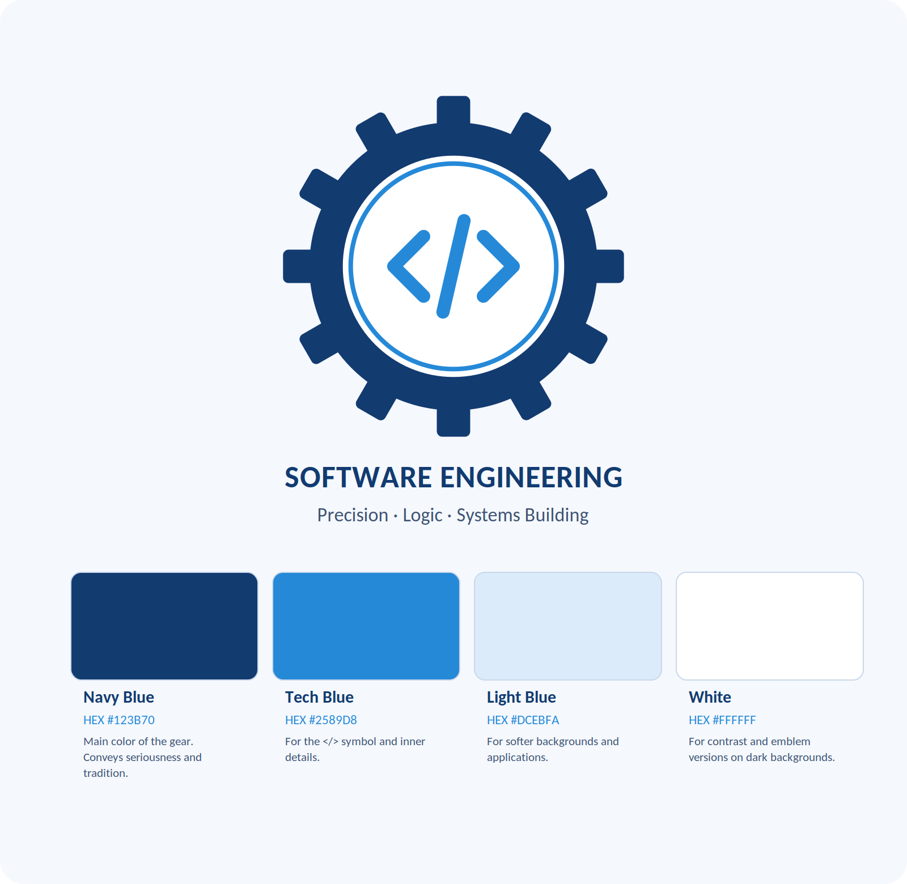

<p align="center">
   symbol inside">
</p>

<h1 align="center">Software Engineering Symbol</h1>

<p align="center">
  <a href="LICENSE"></a>
  
</p>

> [!IMPORTANT]
> **This is a proposal.** It is an independent, conceptual design and **not** a symbol officially recognized by any professional body, university, or standards organization.

## About the Project

This project presents a visual proposal for a symbol representing Software Engineering, combining classic engineering elements with programming. The goal is a simple, recognizable, and versatile visual identity that anyone can use, adapt, and discuss.

## Concept

* **Gear:** represents engineering, precision, and the functioning of systems.
* **`</>`:** represents code and software development.
* **Navy blue and tech blue:** represent trust, knowledge, and technology.

## Color Palette

The colors used in the symbol:



| Color | HEX | Where it is used |
|-------|-----|------------------|
| Navy Blue | `#123B70` | Main color of the gear. Conveys seriousness and tradition. |
| Tech Blue | `#2589D8` | The `</>` symbol and the inner ring. |
| Light Blue | `#DCEBFA` | Soft backgrounds and applications. |
| White | `#FFFFFF` | Contrast, the inner circle, and emblem versions on dark backgrounds. |

## Design Details

* A gear with **12 rounded teeth**, in Navy Blue.
* An inner circle with a thin **Tech Blue ring**.
* A **`</>`** symbol drawn with rounded strokes, entirely in Tech Blue.
* Caption: *Software Engineering* and *Precision · Logic · Systems Building* (set in Carlito, a free font compatible with Calibri). The emblem works with or without the caption.

## Download

| Version | Best for | Files |
|---------|----------|-------|
| Color | Light backgrounds | [SVG](assets/svg/emblem.svg) · [PNG 512](assets/png/emblem-512.png) · [PNG 2048](assets/png/emblem-2048.png) |
| Dark | Dark backgrounds | [SVG](assets/svg/emblem-dark.svg) · [PNG 512](assets/png/emblem-dark-512.png) · [PNG 2048](assets/png/emblem-dark-2048.png) |
| Monochrome | Print, favicon, single-color use | [SVG](assets/svg/emblem-mono.svg) · [PNG 512](assets/png/emblem-mono-512.png) · [PNG 2048](assets/png/emblem-mono-2048.png) |

All PNGs have transparent backgrounds and come in 256, 512, 1024 and 2048 px (see `assets/png/`). The SVG files are vector and scale to any size.

## How to Use

```markdown

```

Guidelines:

* Keep clear space around the emblem equal to at least the width of one gear tooth.
* Don't stretch, rotate, or recolor the emblem outside the palette above.
* Use the dark version on dark backgrounds and the monochrome version for single-color media.
* When you present it, please keep it clear that this is a community proposal, not an official symbol.

## License

Released under [CC0 1.0 Universal](LICENSE): free to use, modify, and share, including commercially, with no attribution required (though it is appreciated).

## Contributing

Feedback and ideas are welcome. Open an [Issue](../../issues) to suggest improvements or new variants.

## Status

**Conceptual proposal under development.**

This project does not represent a symbol officially recognized by a professional body.

---


